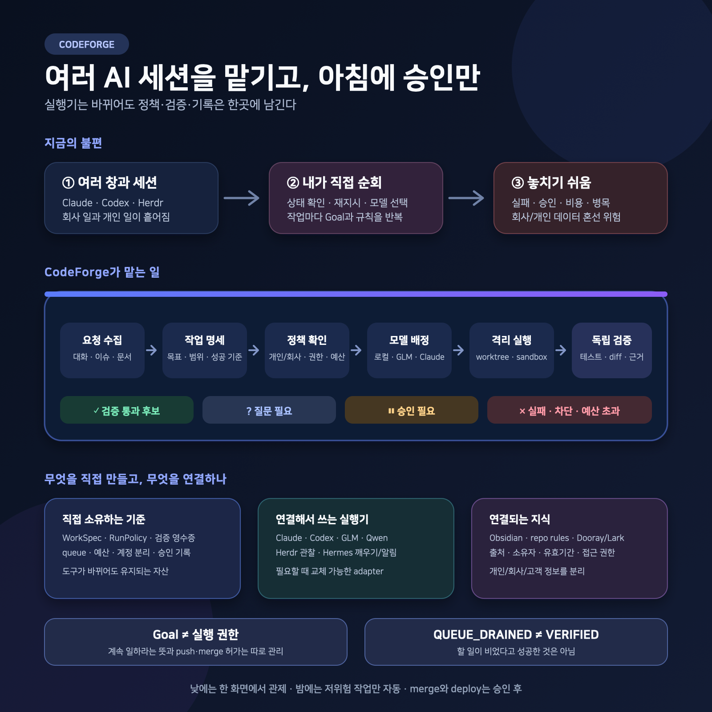

# CodeForge AgentOps — 한눈에 보는 제품 결정

> 상태: 구현·설치 전 권고안
>
> [상세 설계](./11.codeforge-public-service-architecture-debate.md) · [야간 실행기 감사](./12.night-runner-reference-audit-and-design.md)

## 30초 요약

내가 원하는 것은 세션을 더 많이 띄우는 도구가 아니다. 회사 일과 개인 일을 분리한 채 여러 에이전트가 계속 작업하도록 맡기고, 나는 한곳에서 질문·승인 요청·검증된 결과만 확인하는 시스템이다.

CodeForge는 이 시스템의 관제와 신뢰를 맡는다. Claude, Codex, GLM, Qwen 같은 실행기는 필요에 따라 바꿔 쓰되 작업 기준과 권한, 비용, 검증 기록은 CodeForge가 일관되게 관리한다.



핵심 원칙은 세 가지다.

1. `Goal`을 설정했다고 실행 권한까지 생기지는 않는다. 실제 권한은 별도의 `RunPolicy`가 결정한다.
2. `QUEUE_DRAINED`는 할 일이 더 없다는 뜻일 뿐이다. 검증을 통과한 `VERIFIED`와 구분한다.
3. 질문이 생겨도 전체 실행을 세우지 않는다. 답에 의존하는 일만 기다리고, 메인 관제와 다른 안전한 일은 계속 진행한다.

## 지금 불편한 점이 어떻게 바뀌는가

현재는 회사·개인·업무별 세션을 직접 오가며 진행 상황을 확인한다. 어떤 세션이 질문을 기다리는지, 실패했는지, 비용을 많이 쓰는지, 실제로 검증까지 끝났는지를 사람이 기억해야 한다.

CodeForge를 붙이면 흐름이 다음처럼 바뀐다.

```text
대화·이슈·핸드오프
        ↓
작업 명세(WorkSpec)와 권한 정책(RunPolicy) 확정
        ↓
비용·위험도·데이터 구역에 맞는 모델 선택
        ↓
격리된 작업 공간에서 실행
        ↓
에이전트의 자기 보고와 별개로 검사
        ↓
검증된 후보 · 질문 · 승인 요청 · 실패만 한곳에 모음
```

| 때 | 내가 하는 일 | 시스템이 하는 일 |
|---|---|---|
| 낮 | 자연어로 일을 맡기고 필요한 결정만 답한다. | 작업을 명세로 바꾸고 알맞은 실행기에 배정한다. |
| 밤 | 미리 허용한 저위험 작업만 맡긴다. | 예산과 재시도 한도 안에서 격리 실행하고 검사한다. |
| 아침 | 승인함에서 결과와 근거를 보고 채택·수정·폐기한다. | 완료 후보, 질문, 실패 원인과 검증 기록을 정리한다. |

### 메인 세션을 멈추지 않고 결정받는 방법

```text
메인 coordinator ─── 독립 작업 ───────────────────→ 계속 진행
        │
        └─ 결정이 필요한 작업 → WAITING_DECISION
                                  │
                    별도 Decision Concierge
                 Herdr 창 · 웹 · Slack/Discord · 모바일
                                  │ 내 답변
                                  ▼
                         DecisionReceipt
                                  │
                      멈춘 작업만 정확히 재개
```

질문마다 별도 메인 에이전트를 새로 키우지는 않는다. 개인·회사 같은 데이터 구역마다 Decision Concierge 하나를 계속 띄우고, 각 질문만 별도 스레드나 창으로 보여 준다. Herdr처럼 창 단위가 편한 도구에서는 짧은 질문 세션을 새로 열고, 답을 수집한 뒤 자동으로 닫을 수 있다. 사용자의 답은 질문 ID와 작업 버전에 묶여 원장으로 돌아가므로 메인 세션에 복사해 붙일 필요가 없다. 답이 늦거나 작업이 바뀌면 오래된 답은 거부하며, 아무 답도 없을 때 권한이 필요한 행동을 임의로 실행하지 않는다.

## 직접 만들 부분과 가져다 쓸 부분

모든 것을 새로 만들 필요는 없다. 제품의 신뢰를 좌우하는 부분만 직접 소유한다.

| CodeForge가 직접 소유 | 기존 도구와 연동 |
|---|---|
| 작업 명세, 실행 정책, 판정 기준 | Claude, Codex, GLM, Qwen, 로컬 모델 |
| 전역 작업 상태, 재시도, 중단 장치 | Herdr의 세션 관찰과 터미널 제어 |
| 독립 검증과 실행 영수증 | Hermes의 예약 실행·메시징·원격 실행 |
| 개인·회사·고객 데이터 구역 | Obsidian, 저장소 문서, Dooray, Lark |
| 모델 선택 이유와 비용 원장 | ForgeGlow 상태 표시, 외부 모델 전송 계층 |

자체 LLM 게이트웨이, 터미널, IDE, cron, 메신저를 다시 만들지 않는다. CodeForge와 ForgeGlow는 버리지 않는다. CodeForge는 정책·검증 플러그인으로 발전시키고, ForgeGlow는 공개 상태 API를 읽는 가벼운 HUD로 유지한다.

## 언어는 이렇게 운영한다

“AI가 읽는 문서는 AI가 가장 잘 처리하는 형태로 쓰자”는 생각은 맞다. 다만 그 형태가 언제나 영어인 것은 아니다. 공식 OpenAI·Anthropic 지침도 특정 자연어보다 명확한 목표, 관련 맥락, 구조, 예시, 성공 기준을 강조한다. 모델과 작업에 따라 결과가 달라지므로 언어 선택도 평가로 정한다.

### 세 단계로 나눈다

1. 기준 원문: 사실과 규칙을 가장 정확하게 유지할 수 있는 언어로 쓴다. 회사 용어와 한국 업무 맥락은 한국어를 유지하고 코드 식별자와 API 계약은 영어로 둔다.
2. 에이전트용 패키지: 기준 원문에서 현재 작업에 필요한 규칙만 뽑아 모델별로 짧고 구조화된 지시문을 만든다. 전체 문서를 기계적으로 번역하지 않는다.
3. 사람에게 보이는 결과: 한국어는 별도 윤문 단계를 거친다. 영어는 한국어 문장 구조를 옮기지 않고 영어 독자에게 자연스럽게 다시 쓴다.

| 문서·데이터 | 기준 언어 | 운영 방식 |
|---|---|---|
| `AGENTS.md`, 스킬, 에이전트 실행 규칙 | 의미가 가장 정확한 원문 | 모델별로 컴파일하고 실제 성공률로 언어 선택 |
| API, 스키마, CLI, 이벤트 이름 | 영어 | 번역하지 않고 설명만 현지화 |
| Dooray 계획·핸드오프·업무 보고 | 한국어 | 게시 전 한국어 윤문 |
| 공개 OSS `README.md` | 자연스러운 영어 | `README.ko.md`를 자연스러운 한국어로 별도 집필 |
| 공개 설계·RFC | 주요 독자 언어 | 필요한 문서만 다른 언어 요약 제공 |
| 개인·회사 지식베이스 | 출처의 원래 언어 | 검색 뒤 사용자 언어에 맞춰 결과를 작성 |

한국어판과 영어판을 전부 동시에 모델에 넣지는 않는다. 토큰이 늘고 서로 다른 버전이 충돌할 수 있기 때문이다. 각 문서에는 기준 언어와 버전, 번역 상태를 기록한다. 에이전트에는 기준 원문 하나와 필요한 용어표만 전달한다.

### 추측 대신 비교한다

같은 스킬을 세 가지 형태로 시험한다.

- 한국어 원문
- 영어로 새로 쓴 원문
- 기준 원문에서 작업별로 생성한 혼합형 패키지

비교 항목은 기능 성공률, 도구 선택과 인자 정확도, 규칙 위반, 사람이 고치는 시간, 전체 토큰·비용, 응답 시간이다. 모델별 승자를 `LanguageProfile`로 버전 관리한다. 영어를 강제하거나 직역하지 않으며 평가 없이 자동 번역하지 않는다.

참고: [OpenAI Prompt Engineering](https://developers.openai.com/api/docs/guides/prompt-engineering) · [OpenAI Evaluation Best Practices](https://developers.openai.com/api/docs/guides/evaluation-best-practices) · [Anthropic Prompting Best Practices](https://platform.claude.com/docs/en/build-with-claude/prompt-engineering/claude-prompting-best-practices)

## 야간 실행에서 허용할 범위

밤에는 자동 복구가 쉽고 외부 영향을 만들지 않는 작업만 실행한다. 기본 결과물은 격리된 패치나 로컬 커밋이며, 가장 좋은 결과도 `PENDING_REVIEW`로 아침 승인함에 들어간다.

- 작업당 최대 3회, 모델 등급 상향은 2단계, 기본 제한 시간은 60분이다.
- 같은 실패가 두 번 반복되면 멈추고 원인을 보여 준다.
- 비밀정보, 인증, 결제, 운영 환경, DB 마이그레이션, merge, deploy, 외부 메시지는 밤에 실행하지 않는다.
- 비용을 호출 전에 예약하고, 사용량과 가격을 확인할 수 없는 제공자는 자동 실행에서 제외한다.

하네스킷 Autopilot은 제품 기반으로 가져오지 않는다. 대기와 실패의 분리, 읽을 수 없는 상태에서 중단, 재시도 상한처럼 확인된 운영 원칙만 독립적으로 구현한다.

## 모델과 장비를 쓰는 순서

| 등급 | 맡길 일 |
|---|---|
| 로컬 4070 Super | 분류, 요약, 로그 정리, 지식 후보 생성. 평가 전에는 코드 자동 수정 금지 |
| 무료 API | 공개·비민감 보조 작업과 실험 |
| GLM·Qwen 등 저비용 모델 | 검증 방법이 분명한 저·중위험 구현 |
| Claude·Codex | 복잡한 구현, 상위 검토, 하위 모델의 의미 있는 실패 처리 |

싸다는 이유만으로 모델을 고르지 않는다. 승인된 결과 하나를 만드는 총비용을 기준으로 삼는다. 계정 공유, 할당량 우회, 개인·회사 계정의 교차 사용은 지원하지 않는다.

## 지식베이스와 “나의 복제”

사용자에게는 하나의 기억처럼 보이지만, 내부에서는 개인·회사·고객·공개 구역을 분리한다. 작업은 저장소의 구역을 상속하고, 허용된 장비·계정·모델만 사용한다. 회사 정책이 허용하지 않으면 회사 코드를 개인 4070 Super로 보내지 않는다.

Obsidian·Markdown, 저장소 문서, Dooray·Lark를 기준 자료로 유지한다. CodeForge는 출처, 소유자, 버전, 검증일, 만료일, 접근 권한을 기록하고 현재 작업에 필요한 부분만 가져온다. 오래된 채팅 요약이 프로젝트 규칙을 덮어쓰지 못하게 우선순위를 고정한다.

프롬프트 원문 수집은 기본으로 끈다. 사용자가 구역별로 동의한 경우에만 비밀정보와 개인정보를 가리고 보존 기간을 적용한다. GEPA 방식의 개선은 비교 가능한 사례와 별도 검증 세트가 쌓인 뒤, 후보 생성 → 평가 → 시험 적용 → 사람 승인 절차로만 반영한다.

## 만드는 순서

1. 0~3주: 기존 CodeForge의 거짓 성공 판정과 동시 기록 결함을 고치고 실제 사례와 언어별 평가 자료를 모은다.
2. 4~8주: 실행기와 무관한 검증 CLI·GitHub Action을 공개하고 외부 저장소에서 실제 문제를 잡는지 확인한다.
3. 9~14주: 한 사람이 쓰는 야간 실행기와 정적 아침 보고서를 제공한다.
4. 15~18주: 로컬·GLM·Qwen·Claude·Codex의 비용·품질·언어 프로필을 비교하고 ForgeGlow를 연결한다.
5. 19~26주: 팀 승인함과 정책 배포를 검증한 뒤 소규모 팀 유료 파일럿으로 넓힌다.

8주 안에 외부 저장소에서 실제 문제를 잡지 못하면 검증 커널 가설을 접는다. 무단 외부 동작이나 데이터 구역 유출이 한 번이라도 발생하면 무인 실행을 즉시 중단한다.

## 구현 전에 정할 것

1. 새 중립 저장소의 이름과 소유 주체
2. Go 단일 실행 파일과 TypeScript 빠른 초기판 중 선택
3. Apache-2.0 채택과 DCO·CLA 정책
4. 첫 설계 파트너 5명과 공개 사례 수집 경로

현재 권고 기본값은 새 중립 저장소 + Go 코어 + Apache-2.0 + DCO다. 기존 CodeForge와 ForgeGlow는 별도 MIT 프로젝트로 유지한다.
