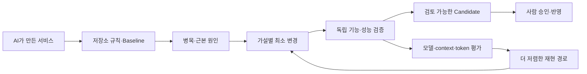

# CodeForge — AI가 만든 소프트웨어를 더 견고하고 효율적으로 만드는 시스템

> 상태: 채택된 제품 북극성 · 단계별 구현 전. 현재 순서와 출시 기준은 [통합 개선 계획](../../plan/code-forge-final-improvement-plan-2026-10-18.md)을 따른다.
>
> [기술 설계](./11.codeforge-public-service-architecture-debate.md) · [24시간 무인 실행 규칙](./12.night-runner-reference-audit-and-design.md)

## 먼저 한 문장

**AI가 빠르게 만든 서비스 위에서 CodeForge는 실제 병목과 취약한 기반을 측정하고, 최소 변경으로 개선하며, 같은 품질을 더 적은 token·비용으로 재현한다. 나는 근거가 모인 후보를 확인하고 실제 반영만 승인한다.**

이제 화면과 기능은 여러 AI 도구로 빠르게 만들 수 있다. 어려운 부분은 그다음이다. 생성된 코드가 오래 유지되는지, 공통 경계가 맞는지, hot path가 느리지 않은지, dependency와 bundle이 불필요하게 커지지 않았는지, 테스트가 실제 동작을 지키는지 다시 확인해야 한다. 같은 결과를 얻기 위해 긴 context와 비싼 모델을 반복해서 쓰는 문제도 남는다.

CodeForge가 바꾸려는 것은 이 개선 방식이다. 세션을 한 화면에 나열하는 것은 부가 기능이다. 중심은 **측정 가능한 소프트웨어 개선과 검증된 에이전트 효율화**다.



## 하루가 이렇게 바뀐다

| 순간 | 지금 | CodeForge를 쓸 때 |
|---|---|---|
| 일을 시작할 때 | 세션을 고르고 모델·프롬프트·규칙을 다시 적는다. | “이 저장소를 더 견고하게 만들어 줘”라고 말하면 규칙·baseline·개선 기준을 고정한다. |
| 여러 작업이 돌 때 | 창을 오가며 상태를 확인한다. | 독립된 작업은 계속 돌고, 막힌 작업만 따로 표시된다. |
| 결정이 필요할 때 | 해당 세션을 찾아 대화를 이어 간다. | 별도 질문 창이나 모바일 알림에 필요한 선택지만 온다. 답을 받은 작업만 다시 움직인다. |
| 작업이 끝났을 때 | 에이전트의 “개선”을 믿고 diff와 테스트를 다시 확인한다. | 기능 비퇴행, 성능 변화, token·비용, 위험과 미확인 항목이 하나의 검토 묶음으로 온다. |
| 실제 반영할 때 | push·PR·merge·배포 범위를 다시 판단한다. | 내가 승인한 정확한 변경과 동작만 실행하고, 반영 뒤 다시 검사한다. |

```text
개선할 저장소와 목표를 맡긴다
    ↓
CodeForge가 규칙·baseline·병목 후보를 확인한다
    ↓
Claude / Codex / GLM / Qwen이 가설별 최소 후보를 만든다
    ↓
CodeForge가 기능·구조·성능·비용을 독립적으로 다시 측정한다
    ↓
질문 · 검토할 결과 · 승인할 동작만 한곳에 모인다
```

낮과 밤은 권한 기준이 아니다. 언제든 같은 방식으로 작동한다. AI는 허용된 범위 안에서 분석·구현·테스트·검토·실행 계획까지 준비하고, 외부 시스템을 실제로 바꾸는 단계에서 승인받는다.

```text
휴대폰·노트북 ── 질문·검토·승인 ── 개인용 관제 코어
                                      ├─ 선택형 GPU worker / 로컬 GLM·Qwen
                                      ├─ Codex·Claude local/managed runtime
                                      └─ 개인 KB·작업 원장

별도 workspace ─ 허용된 상태 요약 ── 해당 realm의 관제 코어
                                      └─ 해당 계정·저장소·KB·credential
```

두 영역은 한 화면에서 상태만 함께 볼 수 있다. 원문, 로그인 정보·키, 작업 원장은 서로 섞지 않는다. 집 데스크톱은 처음에는 관제 코어와 실행기를 함께 돌릴 수 있다. 재부팅 중에도 모바일 승인이 필요해지면 작은 상시 관제 코어를 따로 둔다.

## 사용자가 보는 시작 화면은 다섯 부분이다

1. **개선 요청함** — 자연어 요청을 목표, 범위, baseline과 비퇴행 조건으로 바꾼다.
2. **측정기** — 저장소 profile로 기능·구조·성능·비용 evidence를 수집한다.
3. **최적화 실행기** — Claude나 Codex 같은 기존 도구가 격리된 공간에서 가설별 최소 후보를 만든다.
4. **독립 검증기** — 실행기의 자기 평가와 별개로 base와 candidate를 다시 비교한다.
5. **질문·승인함** — 근거가 있는 후보와 사람이 판단할 내용만 모은다.

사용자가 직접 다루는 부분은 이 다섯 가지다. 내부에는 작업을 잃지 않는 원장과 휴대폰에서도 여는 웹 승인함이 첫 버전부터 포함된다. 지식 그래프, 자체 모델 게이트웨이, 전용 모바일 앱과 팀 서버는 뒤에 만들 수 있다.

## 왜 Codex 앱이나 Claude Managed Agents만 쓰지 않는가

최신 Codex와 Claude 플랫폼은 장기 session, sandbox, subagent, 복구, event와 도구 승인까지 제공한다. 이 실행 기능은 적극 재사용한다. CodeForge가 다시 만들 이유가 없다.

하지만 한 제품의 session은 다른 provider, 기존 terminal, 저장소별 baseline과 CI, 조직·개인 realm까지 함께 책임지지 않는다. CodeForge가 직접 소유할 것은 **어떤 병목을 어떤 기준으로 측정했고, 무엇을 바꿨으며, 기능과 비용이 어떻게 달라졌고, 누가 어떤 실제 동작을 승인했는지**다. 실행기는 바뀌어도 이 기록과 권한은 이어진다.

## 도구 이름이 많은 이유

도구는 필요한 기능이 생길 때 하나씩 연결한다. CodeForge는 여러 도구 사이에서 사라지면 안 되는 작업 상태·권한·검증 기록만 소유한다.

| 도구 | 쓰는 이유 | 처음부터 필요한가 |
|---|---|---|
| CodeForge | 작업 기준, 권한, 검증, 결과 기록을 일관되게 관리한다. | 필수 코어 |
| Claude·Codex 등 | 실제 분석과 코딩을 수행한다. 작업에 따라 교체할 수 있다. | 하나 이상 필요 |
| Git worktree·테스트 | 작업을 격리하고 결과를 저장소 기준으로 확인한다. | 코드 작업에 필요 |
| Herdr | 지금처럼 여러 터미널 세션을 보고 제어하는 화면으로 쓴다. 작업의 상태와 완료는 CodeForge가 판정한다. | 선택. 현재 작업 방식에는 유용 |
| Hermes | 항상 켜진 장비를 깨우고, 예약 실행·원격 실행·메신저 알림을 연결한다. | 선택. 처음에는 `launchd`·`cron`으로 대체 가능 |
| Obsidian | 개인 지식을 사람이 직접 읽고 고치는 편집 화면으로 쓴다. 실제 자료는 평범한 Markdown으로 남는다. | 선택. Markdown 폴더만으로 시작 가능 |
| 문서·이슈 시스템 | 원래 자료 위치와 권한을 유지한 채 필요한 부분만 참조한다. | 해당 작업에서만 연결 |
| ForgeGlow | 현재 상태와 비용을 가볍게 보여 주는 HUD로 쓴다. | 선택. 코어가 안정된 뒤 연결 |

### Obsidian을 고려한 이유

“나의 복제”가 오래 쓰이려면 AI가 자동으로 모은 기억만 있어서는 안 된다. 내가 직접 읽고 고치며 연결할 수 있는 개인 지식 공간이 필요하다. Obsidian은 Markdown을 그대로 다루고 로컬에서도 쓸 수 있어 후보가 됐다.

Obsidian은 선택형 편집기다. CodeForge는 Markdown, 저장소 문서, 외부 문서·이슈 시스템 같은 출처의 위치·버전·권한만 관리한다. 같은 Markdown 폴더를 다른 편집기로도 열 수 있어야 한다. 그래프 기능은 실제로 도움이 된다는 증거가 생긴 뒤에 붙인다.

### Hermes를 고려한 이유

24시간 일하려면 작업을 깨우는 기능, 집 데스크톱이나 원격 장비에서 실행하는 기능, Slack·Discord 같은 곳으로 질문과 결과를 보내는 기능이 필요하다. Hermes가 이미 이 기능을 제공하므로 CodeForge가 cron·메신저·원격 실행기를 다시 만들 필요가 없다.

Hermes도 **선택형 연결 부품**이다. 작업의 진짜 상태와 권한은 CodeForge가 관리한다. 처음에는 운영체제의 `launchd`나 `cron`으로 CodeForge를 깨우면 충분하고, 원격 실행이나 여러 알림 채널이 필요해질 때 Hermes를 붙인다.

## 실제 사용 장면

가상의 `sample-app` 기능 개선과 `sample-docs` 문서 작업을 서로 다른 realm에서 동시에 맡겼다고 가정한다.

1. CodeForge는 두 작업을 `realm-a`와 `realm-b`로 나눈다.
2. 각 작업의 realm·데이터·동작에 허용된 계정과 장비만 사용한다. 계정 이름이나 폴더 위치만으로 자동 판정하지 않는다.
3. `sample-app`에서 API 정책 선택이 필요하면 그 작업만 기다리고, `sample-docs` 작업은 계속된다.
4. 질문은 별도 창이나 알림으로 온다. 답변은 질문과 작업 버전에 묶여 해당 작업으로 돌아간다.
5. 각 실행기는 구현과 검사를 마친 뒤 `CandidatePackage`를 만든다. 여기에는 diff, 테스트, 위험, 미확인 항목, 되돌리는 방법이 들어간다.
6. 저장소가 미리 허용한 경우에만 draft PR을 열 수 있다. merge·배포·운영 변경은 내가 정확한 변경을 승인한 뒤 실행한다.
7. 반영 뒤 다시 검사해 실제 완료 여부를 기록한다.

한 작업이 질문을 기다린다고 전체 관제가 멈추지 않는 것이 핵심이다.

## 어디까지 AI에게 맡기는가

| 작업 | AI가 먼저 준비 | 사람이 승인한 뒤 반영 |
|---|---|---|
| 코드·문서 | 변경안, local commit, 검사 결과, PR 설명 | push, PR 공개, merge |
| DB·인프라 | migration·IaC 변경, dry-run, 영향과 복구 계획 | 실제 migration, 운영 변경, 배포 |
| 인증·결제·비밀정보 | placeholder 기반 변경안과 교체·복구 절차 | 실제 키·결제·운영 credential 변경 |
| 메일·메신저·외부 시스템 | 정확한 발송문과 변경 미리보기 | 실제 발송과 외부 데이터 변경 |

PR도 외부 쓰기다. CI와 알림을 실행하고 코드를 공개할 수 있으므로, 저장소가 미리 허용한 경우에만 자동으로 연다. 그 외에는 동일한 내용을 로컬 검토 묶음으로 남긴다.

## 처음 만들 범위

G2 개인 alpha는 runtime 하나로 다음 흐름을 끝까지 완성한다. 제품의 멀티모델 지원은 G3에서 Claude·Codex 두 runtime과 두 native pack을 검증한 뒤 선언한다.

```text
작업 여러 건 입력
  → durable 원장에 목표·규칙·baseline·출처 기록
  → Claude 또는 Codex 한 종류로 격리 실행
  → 질문이 필요한 작업만 기다리고 나머지는 계속 진행
  → 공개 저장소 profile 하나로 병목·최소 candidate·기능 비퇴행·metric을 독립 검증
  → 반응형 웹 승인함에서 결정·채택·수정·폐기
  → 승인된 정확한 동작만 별도 실행기가 반영하고 재확인
```

첫 버전에 넣지 않는다.

- Obsidian 전용 플러그인과 지식 그래프
- Hermes 의존 실행 구조
- 자체 LLM 게이트웨이
- Slack·Discord 전체 연동과 native 모바일 앱
- 팀용 Hub와 분산 스케줄러
- GEPA 기반 자동 프롬프트 변경

장기 설계를 한 번에 배포하지는 않는다. 대신 첫 제품부터 사용자가 세션을 찾아다니지 않아도 되는 완전한 흐름을 제공한다. 실제 측정 결과는 adapter·질문 방식·검토 묶음·routing을 개선하는 데 쓰며, 2주 실험 하나로 전체 목적지를 폐기하지 않는다.

## 확장 순서

1. 개인용 최적화 수직 단면 — 공개 저장소 profile 하나에서 baseline, 병목, 최소 candidate, 독립 검증, 승인, 반영·재확인을 연결한다.
2. 범용성 검증 — Claude·Codex 두 계열과 성격이 다른 두 번째 저장소 profile을 같은 계약으로 검증하고 Herdr·ForgeGlow를 관찰 화면으로 붙인다.
3. 24시간·교차 기기 — 데스크톱 worker, 모바일 웹, managed runtime과 장애 복구를 붙인다.
4. 지식 연속성 — 첫날부터 쌓은 출처를 바탕으로 Markdown·Obsidian·외부 문서 검색과 갱신을 완성한다.
5. 저비용 모델과 개선 루프 — GLM·Qwen·로컬 모델을 task별로 평가하고, holdout을 통과한 prompt·skill 후보만 승격한다. 실제 hotspot에는 기준 수치 측정 → 격리 최적화 → CI 재측정 → 성공 후보만 PR로 올리는 recipe를 붙인다.
6. 팀 서비스 — 여러 사람이 같은 승인함과 조직 정책을 필요로 할 때 Hosted Hub를 만든다.

## 지식과 언어 운영

지식은 하나처럼 검색하되 사용자·workspace·tenant·공개 영역의 권한을 지킨다. 저장소 규칙과 원래 시스템의 최신 문서가 오래된 채팅 요약보다 우선한다. 원문, 출처, 버전, 확인 날짜, 접근 권한을 함께 기록한다.

문서 언어는 독자와 정확도를 기준으로 고른다. API·스키마 식별자는 영어로 유지하고, 조직 정책과 지역별 업무 맥락은 정확한 원문을 쓴다. 에이전트에는 현재 작업에 필요한 부분만 짧게 전달한다. 사람에게 보여 주는 한국어는 자연스럽게 다듬고, 공개 영어 문서는 영어 독자를 기준으로 별도로 쓴다.

## 바뀌지 않는 원칙

1. 에이전트의 “완료했습니다”만으로 완료 처리하지 않는다.
2. 질문 하나가 전체 작업을 멈추게 하지 않는다.
3. 조직·개인·고객 데이터와 계정을 섞지 않는다.
4. 검토 후보 준비와 실제 반영 권한을 분리한다.
5. CodeForge가 터미널·메신저·모델 실행기까지 모두 다시 만들지 않는다.
6. token 절감 때문에 기능·안전·유지보수 기준을 낮추지 않는다.

기술 객체와 상태 전이, 보안 규칙, 출시 지표가 필요할 때만 [기술 설계](./11.codeforge-public-service-architecture-debate.md)를 읽으면 된다.
