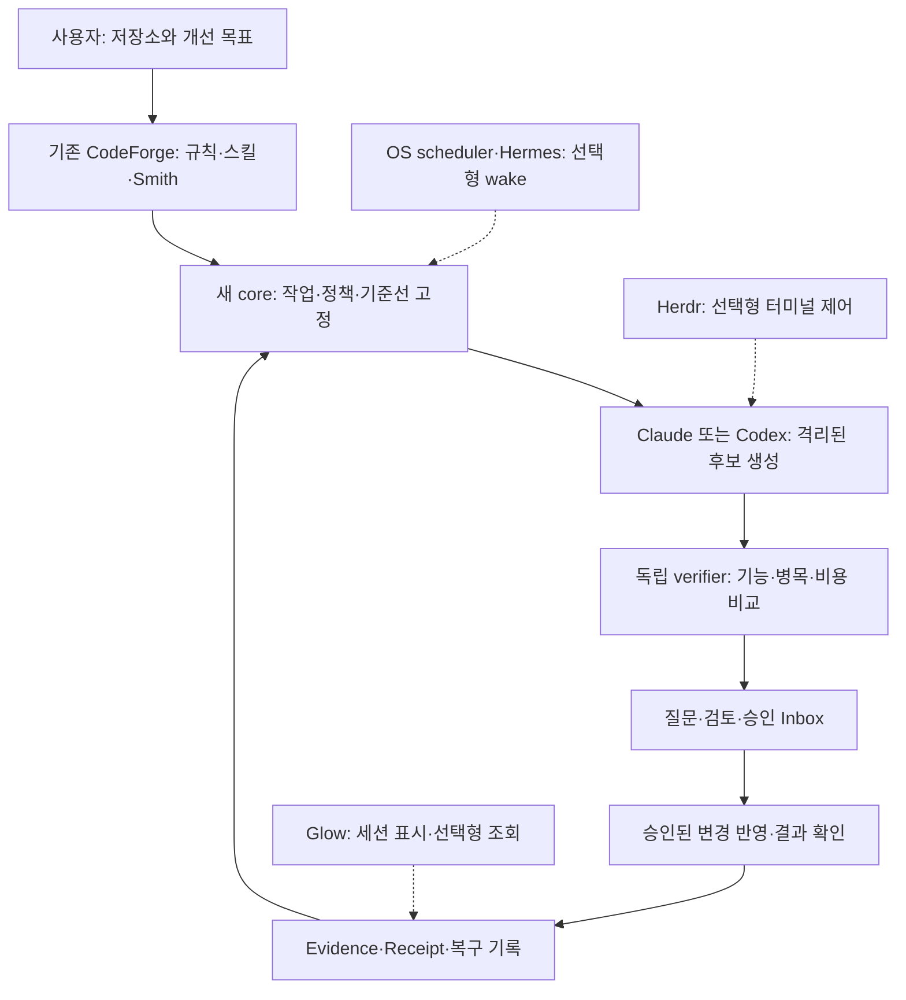

# CodeForge AgentOps 설계 문서 지도

> 상태: 제품 북극성 유지 · 2026-10-21 관리형·개인화·보안 요구 반영 · 제품 구현 전
>
> 초기 사용자: 여러 AI 코딩 세션을 함께 쓰는 개인 개발자와 소규모 팀

## 먼저 볼 문서

최신 전체 그림은 [서비스 설계 HTML](./codeforge-service-design-review-2026-10-21.html)을 내려받아 브라우저에서 연다. [관리형·개인화 상세 계획](./13.hosted-personalized-service-plan.md)은 보안 경계·학습·수익 구조와 요구사항별 완료 조건을 정리한다. 실행 순서는 아래 통합 개선 계획의 2026-10-21 개정본이 기준이다. 이번 개정은 Claude 재검수를 받지 않았다.

1. [AI가 만든 소프트웨어를 더 견고하고 효율적으로 만드는 시스템](./11b.codeforge-public-service-summary.md) — 제품이 해결할 문제와 실제 개선 루프부터 읽는다.
2. [2026-10-18 통합 개선 계획](../../plan/code-forge-final-improvement-plan-2026-10-18.md) — 현재 구현 순서·저장소 책임·통과 기준의 단일 기준이다.
3. [공개 서비스 설계](./11.codeforge-public-service-architecture-debate.md)와 [24시간 실행과 승인 설계](./12.night-runner-reference-audit-and-design.md) — 상세 요구사항을 확인한다.

## 문서별 지위

| 문서 | 현재 지위 | 읽는 목적 |
|---|---|---|
| [2026-10-18 통합 개선 계획](../../plan/code-forge-final-improvement-plan-2026-10-18.md) | 실행 순서 기준 | 기존 제품 수리·두 host pack·새 core·출시 gate와 과거 단계 매핑 확인 |
| [관리형·개인화 상세 계획](./13.hosted-personalized-service-plan.md) | 최신 제품 요구사항 | hosted-first·선택 context·조직 분리·prompt 학습·원가·출하 조건 |
| [서비스 설계 HTML](./codeforge-service-design-review-2026-10-21.html) | 시각화 검토 자료 | 제품 구조·메타포·비용 계산·리서치 출처 |
| [통합 최종 검수](./evidence/2026-10-18-integrated-plan-review.md) | 10월 18일 검수 이력 | 당시 Codex·Claude 반론과 검사 범위. 10월 21일 개정 검수로 해석하지 않음 |
| [08 Herdr·OMP·Hermes·Qwen 재검토](./08.herdr-omp-hermes-qwen-control-plane-review.md) | 초기 비교 자료 | 기존 도구의 기능과 한계를 확인 |
| [09 CodeForge 중심 장기 설계](./09.codeforge-owned-agent-system-design.md) | 채택된 북극성 | 확장 가능한 전체 구조와 단계별 목적지를 확인 |
| [10 Thin Coordinator 검증](./10.codeforge-thin-coordinator-overengineering-validation.md) | 역사적 판단 기록 | 초기 과잉설계 논쟁과 작은 관찰 실험의 측정법을 확인 |
| [11 공개 서비스 최종 설계](./11.codeforge-public-service-architecture-debate.md) | 제품 요구사항 | 목적·계약·중단 기준 확인. 구현 순서는 통합 계획 적용 |
| [11b 제품 이야기](./11b.codeforge-public-service-summary.md) | 사람용 진입점 | 사용 장면, 최소 구성과 선택형 도구의 이유를 이해 |
| [12 무인 실행 최종 설계](./12.night-runner-reference-audit-and-design.md) | 실행 하위 계획 | 24시간 준비와 인간 반영 게이트를 구현 |
| [북극성 독립 검토](./evidence/2026-10-15-independent-north-star-review.md) | 최신 교차 검토 근거 | 과거 MVP 제약을 뒤집은 이유와 최신 runtime의 역할·한계를 확인 |

08번과 10번은 당시 판단을 보존한다. 09·11·11b·12의 제품 목적과 상세 요구사항은 유지하고, 실행 순서·지원 범위·기술 재결정은 통합 개선 계획을 따른다.

## 현재 제품 결정

CodeForge는 빠르게 생성된 소프트웨어를 저장소 기준으로 측정하고, 근본 원인을 찾아 최소 변경으로 개선하며, 같은 품질을 더 적은 토큰·비용으로 재현하는 검증·최적화 계층이다. 여러 모델과 실행기를 직접 대체하지 않고 작업 명세, 권한, 데이터 분리, 비용, 독립 검증, 실행 기록과 승인함을 소유한다. Claude, Codex, GLM, Qwen, Herdr, Hermes 같은 도구는 어댑터로 연결한다.

시간대는 권한 기준이 아니다. 허용된 모든 작업 유형을 받아 격리 환경에서 가능한 검증까지 끝내되, `CandidatePackage` 작성과 실제 push·PR 공개·merge·deploy를 분리한다. 저장소 정책이 허용하면 draft PR까지 자동으로 열고, 실제 반영은 정확한 artifact digest에 묶인 승인 뒤에만 수행한다.

실행 중 판단이 필요해도 전체 작업을 멈추지 않는다. 결정에 의존하는 노드만 `WAITING_DECISION`으로 두고, 메인 coordinator는 독립적으로 진행할 수 있는 일을 계속한다. 별도 Decision Concierge가 전용 창·스레드·모바일 카드로 질문하고, 답을 versioned `DecisionReceipt`로 원장에 돌려보낸다.

언어도 하나로 고정하지 않는다. 에이전트용 스킬과 규칙은 모델·작업별 `LanguageProfile` 평가로 선택한다. 한국어 사용자 문서는 윤문하고, 공개 영어 문서는 영어 독자에게 자연스럽게 별도로 작성한다.

## 구현 순서

1. G0a에서 기존 WIP를 복원 가능한 상태로 보존하고 G1a 안전성 수리를 시작한다. G0b 계약 실증과 G1b 두 host pack은 각 선행 조건 뒤 진행한다.
2. G2에서 runtime 하나·공개 repo 하나의 측정·최소 변경·독립 검증·질문·승인·반영 확인과 단일 장비 무인 복구를 완성한다.
3. G3에서 Claude·Codex 두 runtime·두 pack·두 profile과 Glow·Voice 호환을 검증한다.
4. G4에서 원격 모바일·별도 authority/worker를 검증하고, 지식 검색·저비용 모델·prompt 개선은 수요와 eval 뒤 확장한다.
5. 팀의 공유 승인·정책 수요가 확인되면 Hosted Hub를 검토한다. 구체 gate와 과거 단계 매핑은 통합 계획을 따른다.

현재 문서는 설계와 출시 판단이다. 새 코어, 무인 실행기, Hosted Hub, 모델 설치와 계정 연결은 아직 구현하지 않았다.

## ★ CURRENT — 다음 세션 인계

- **현재 상태**: 계획 브랜치의 `e05552cd`와 최신 main의 `e9b9c1f`를 통합해 검수했다. 제품 구현은 시작하지 않았다. 원본 작업트리의 안전성·상태 WIP는 별도 보존 중이며 통합 코드로 계산하지 않는다.
- **확정한 결정**: CodeForge가 신뢰 커널과 전역 Work 원장을 소유하고, runtime·terminal·model·notification은 교체 가능한 adapter로 연결한다. `VerificationRecipe`는 범용 계약으로 두고 실제 명령과 지표는 `RepositoryProfile`이 제공한다. 토큰 최적화는 품질 gate를 유지한 상태의 verified completion당 비용으로 판정한다.
- **반복하지 않을 것**: 특정 조직의 비공개 프로젝트나 계정 규칙을 공개 코어에 넣지 않는다. 특정 프론트엔드·언어·benchmark 도구를 코어 schema에 고정하지 않는다.
- **바로 할 일**: 통합 계획의 G0a 복원 리허설과 G0b 최소 계약 fixture를 준비한다. G1a 안전성 수리는 G0a 완료 뒤 시작할 수 있다. 새 core 언어·이름은 G0b 실증 뒤 ADR로 확정한다.
- **검증할 것**: 성격이 다른 두 공개 저장소 profile이 같은 verifier 계약을 통과하고, 품질 비퇴행 조건에서 코드 또는 에이전트 비용을 실제로 개선하는지 확인한 뒤 SDK 경계를 확정한다.
- **먼저 읽을 곳**: 11b 제품 이야기 → 통합 개선 계획 → 현재 통합 검수 기록 → 필요한 상세 설계 순서로 읽는다.
