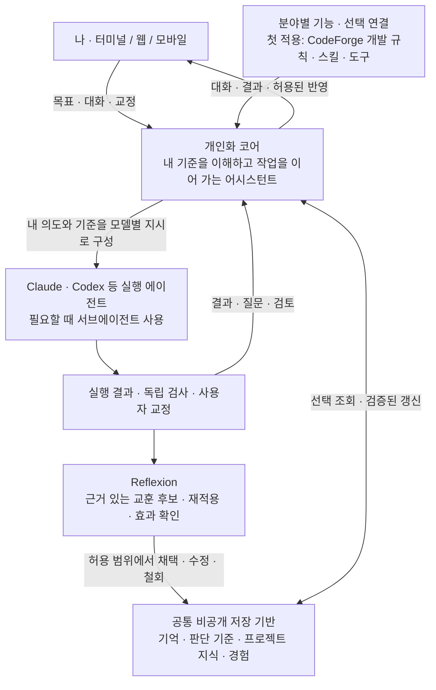

# CodeForge 개인 어시스턴트 한눈에 보기

2026-10-25 · 제품 검토 요약. 아래는 만들려는 서비스이며 구현·출시 완료를 뜻하지 않는다.

**여러 모델이 하나의 개인화 코어를 활용해, 함께 일할수록 나를 더 잘 이해하고 내 기준으로 일하는 개인 어시스턴트.** 첫 적용 분야는 개발 작업이다. 터미널에서 기존처럼 일하고, 웹·모바일에서도 같은 어시스턴트와 이어서 작업한다.

## 여기서 어시스턴트란

| 용어 | 역할 |
|---|---|
| **개인 어시스턴트** | 나와 계속 일하며 승인된 기억·판단 기준·진행 중인 일을 이어 가는 제품 경험 |
| 실행 에이전트 | Claude·Codex 등에서 현재 작업을 수행하는 실행 단위 |
| 서브에이전트 | 조사·검토 등 필요한 부분을 위임받는 선택적 작업자 |

제품의 중심은 기억·판단·경험을 함께 관리하는 코어다. 웹·모바일·터미널은 접근 수단이고, 사용자에게는 하나의 어시스턴트가 이어진다. 내부 모델이나 작업자는 바뀔 수 있다. 프로젝트마다 역할 파일을 많이 만드는 것이 개인 어시스턴트를 만든다는 뜻은 아니다.

## 쓰면서 무엇이 달라지나

| 시점 | 기대하는 경험 |
|---|---|
| 처음 | 프로젝트 지침을 읽고 바로 일을 돕는다. 긴 성향 설문이나 기억 입력부터 요구하지 않는다 |
| 교정한 뒤 | “이 프로젝트에서는 새 라이브러리보다 기존 코드를 먼저 활용해 줘”라는 기준을 알려 주면 적용 범위를 확인해 기억한다 |
| 다음 관련 작업 | 같은 설명을 반복하지 않아도 그 기준으로 선택하고, 결과를 바꾼 판단 근거를 보여 준다 |
| 기준이 바뀌면 | “이번만 예외야”와 “앞으로는 바꿔 줘”를 구분한다. 잘못된 기억은 수정·삭제할 수 있다 |
| 도구·화면을 바꾸면 | 허용된 기억과 작업 근거를 이어 간다. 터미널 작업의 질문에 모바일로 답하고 다시 터미널에서 계속한다 |

**오래 썼다는 사실보다, 같은 교정·불필요한 질문·원치 않는 선택이 줄어드는 것이 가치다.** 어시스턴트는 사용자의 선호를 고려하면서도 근거 있는 반론을 제시한다. 회사와 개인의 자료·권한은 분리한다.

## 전체 서비스 구성도

코어는 관련 기억을 골라 각 모델에 맞는 지시를 구성하고 권한·비용·진행 상태를 관리한다. 작업 뒤에는 실제 검사와 교정을 근거로 다음에 적용할 교훈을 남긴다. Reflexion은 이 피드백 활용 방식이며, 모델의 자기평가를 곧바로 사실이나 사용자 선호로 저장하지 않는다.

기억은 세션 밖에 보존하되 매번 전부 주입하지 않는다. 하나의 저장 기반 안에서도 개인·회사 정보는 권한에 따라 분리하고, 기존 제공자의 모든 대화를 자동 수집하지 않는다. 모델을 바꿔도 내 기준을 이어 주는 것이 목표이며 모델별 능력 차이를 없앨 수 있다고 약속하지 않는다.

## 기존 CodeForge와는 어떤 관계인가

| | 기존 CodeForge | 관리형 개인 어시스턴트 |
|---|---|---|
| 제공 가치 | 로컬 도구에 필요한 규칙·스킬·설정 제공 | 공통 기억과 모델별 지시, 결과·교정 기반 학습, 작업·검증·복구 관리 |
| 접점 | Claude Code·Codex 등 지원 로컬 도구 | 터미널·웹·모바일 |
| 이용 방식 | 무료 OSS 독립 사용 유지 | 계정으로 연결해 사용, 로컬 설치·BYOK는 선택 |
| 연결 | 재사용할 지침과 도구를 관리 | 검증된 CodeForge 기능을 사용 |

개인화 코어는 CodeForge·Git·관리형 실행에 묶지 않는다. 기존 도구에 기억과 판단 기준만 연결할 수도 있고, 필요할 때 실행·검증·복구까지 맡길 수도 있다. 첫 시장은 개발자로 좁히되 다른 분야의 작업도 연결할 수 있는 구조로 설계한다. 연결 지원은 실제 호스트 검증 뒤 선언한다.

플러그인은 기능을 전달하는 방식이다. Claude·Codex에 잘 맞는 형식으로 제공하고, 관리형 제품은 필요한 기능을 직접 활용한다. 현재 Claude 플러그인은 존재하고 Codex는 부분 지원 상태다. 새 서비스 이름·저장소 경계는 미정이다.

기존 사용자 설정과 수정한 파일을 보존하며 허용한 호환 업데이트는 검증 후 적용한다. Smith의 역할 생성은 필요한 경우만 사용하고, 로컬 Voice·Glow의 유용한 기능은 이어 간다. 개인 코딩 연습은 별도 `coding-practice`에 남기며 어시스턴트의 필수 기능에 포함하지 않는다.

## 왜 기존 도구 대신 돈을 내야 하나

**경쟁 우위는 아직 가설이다.** [Claude의 기억](https://code.claude.com/docs/en/memory), [Devin의 기억](https://docs.devin.ai/product-guides/memory), [Cursor의 자동화·검사 결과물](https://cursor.com/en-US/cloud)처럼 경쟁 제품도 비슷한 기반 기능을 제공한다. 2026-10-25 공식 문서를 확인했으며 실사용 성능 비교는 아직 하지 않았다.

[Letta](https://www.letta.com/agent/)도 학습하는 개인화 에이전트와 모델 간 기억 이전을 제시하고, [Mem0](https://docs.mem0.ai/introduction)는 여러 도구에 기억을 연결한다. **공통 기억 자체만으로는 차별화되지 않는다.** 기억 API 사업까지 동시에 벌리기보다 기존 도구에서 반복 교정을 줄이는 경험부터 검증한다.

검증할 차이는 **사용을 거듭할 때 내 기준에 맞는 결과가 더 자주 나오고, 내가 다시 설명하고 고치는 일이 줄어드는가**다. 한 모델만 쓰는 사용자에게도 이득이 있어야 한다. 여러 도구에서 기억이 이어지는 것은 그 가치를 확장하는 기능이다.

잠재적 강점은 승인된 기준·교정·실제 결과의 연결과 기존 도구를 유지할 수 있다는 점이다. 약점은 추가 구독·설정 부담, 잘못되거나 오래된 기억, 호환·운영 비용, 공급자가 같은 경험을 제공할 위험이다. 사용자가 데이터를 내보내고 떠날 수 있어도 계속 쓰고 싶을 만큼 유용해야 한다.

첫 고객은 기존 프로젝트를 반복 관리하는 개발자로 좁혀 검증한다. **기억 기능까지 잘 설정한 기존 도구**와 비교해 품질, 반복 교정, 수용한 결과당 설명·검토·재작업 시간, 전체 비용을 본다. 개인화 효과는 시간에 따라 확인하고 실제 반복 사용·결제로 사업성을 판단한다. [경쟁 비교와 사업 검증](./13.hosted-personalized-service-plan.md#6-가격수익-가설과-계약-검토)에 장점·약점과 실험을 남겼다.

## 첫 제품과 이후 확장

| 첫 제품에 포함 | 효과를 확인한 뒤 확장 |
|---|---|
| 기억 없이도 유용한 첫 작업, 공통 기억과 모델별 지시·다음 작업 적용 | 고급 지식 검색, 지침·맥락 선택의 자동 최적화 |
| 기억 조회·수정·삭제·끄기, 예외 구분, 근거 기반 Reflexion의 최소 흐름 | 더 많은 실행기와 작업 유형의 개인화 평가 |
| 한 작업의 실행·검증·질문·승인·취소·재개 | 조직 설치형·폐쇄망·로컬 장비 원격 연결 |
| 터미널·웹·모바일 연결, 기본 음성 전사 확인 | 실시간 음성 대화·상시 호출 |

음성은 녹음 → 전사 확인·수정 → 기존 작업에 전송하는 경로부터 제공한다. 작업 비용에는 모델·음성·실행 환경을 포함하고 상한을 둔다. 임시 미리보기와 완성된 앱의 상시 운영 비용은 구분한다. 구독 가격은 아직 가설이다.

구현은 기존 변경 보존·안전성 정리 → 한 실행기에서 작업과 기본 개인화 실증 → 관리형 고객 경험 순으로 진행한다. **기본 기억을 후순위 연구 과제로 미루지 않는다.** 기억이 실제 결과를 개선하는지 먼저 확인하고, 더 복잡한 자동 최적화를 붙인다.

## 상세 문서

- [서비스 계획](./13.hosted-personalized-service-plan.md): 어시스턴트의 경험, 개인화 과정, 경쟁·사업성, 정보와 비용의 경계.
- [통합 구현 계획](../../plan/code-forge-final-improvement-plan-2026-10-18.md): 책임 분리, 구현 순서, 단계별 완료 조건, 기존 사용자 전환.

이 요약은 두 계획의 안내이며 세부 실행 순서·지원 범위는 통합 구현 계획을 따른다.
