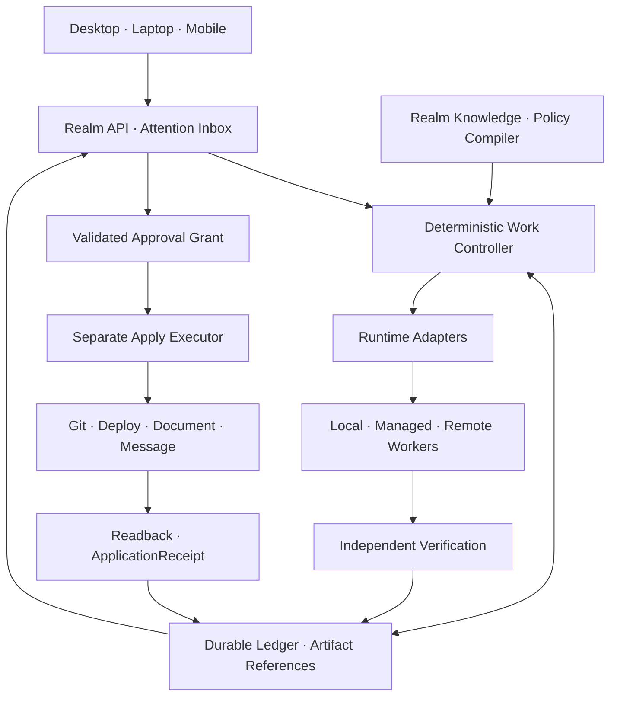

# CodeForge 북극성 독립 검토

> 검토일: 2026-10-15
>
> 검토 방식: Codex read-only architecture review · high reasoning
>
> 기준: code-forge `c36edb8`
>
> 범위: `docs/agentops/08~12`, CodeForge 설계 원칙과 현재 구현 표면, 공식 runtime 문서
>
> 실행 조건: read-only. 저장소 파일·credential·runtime integration을 변경하지 않았다.

## 판정

**BUILD WITH MAJOR CHANGES — 신뢰도 85/100.**

CodeForge가 work·policy·approval·evidence·knowledge 계약을 소유하고 외부 runtime이 실행을 맡는 D안을 유지한다. 새 host-neutral 제품 저장소는 monorepo로 만들고, 현재 code-forge는 독립 사용 가능한 Claude harness·skill·policy pack과 compatibility adapter로 남긴다.

목적지는 유지한다. enforcement, durable execution, runtime 통합과 구현 순서는 크게 고친다. 사용자가 원하는 제품은 여러 작업을 실제로 이어 주고 결과 반영까지 통제해야 한다.

> 여러 실제 작업을 서로 다른 agent에게 맡기고, 중요한 질문에 한곳에서 답하며, 검증된 결과와 정확한 반영 통제를 받는 시스템.

## 과거 검토에서 유지할 것

- Dooray, Git, provider session의 정본을 복제하지 않고 field별 소유자와 source revision을 남긴다.
- agent의 완료 주장과 evidence로 검증된 결과를 분리한다.
- terminal, agent loop, model transport, messenger와 cron은 기존 구현을 재사용한다.
- Herdr·Hermes·OpenHands·OMP 같은 외부 도구는 adapter 또는 선택형 surface로 연결한다.
- 회사와 개인 데이터는 realm별로 격리하고 prompt에만 맡기지 않는다.

## 과거 검토에서 폐기할 것

| 과거 제약 | 재판정 |
|---|---|
| 엔티티가 많으므로 전체 Control Plane은 과잉설계 | entity 수보다 서로 다른 수명주기와 권한을 올바르게 분리했는지가 중요하다. |
| 읽기 전용 dashboard 뒤에 approval·remote·KB를 검토 | 비동기 질문, 승인과 기본 지식 연속성은 핵심 경험이므로 첫 수직 단면에 포함한다. |
| PR verifier 판매나 2주 실험 성공 뒤에 runner 구현 | 좁은 상품 가설을 전체 아키텍처의 veto로 사용하지 않는다. |
| run별 JSON 파일에서 시작 | 24시간 queue·decision·approval·UI가 동시에 쓰므로 첫날부터 SQLite WAL과 transaction outbox를 사용한다. |
| 동일 Work는 재시작 뒤 절대 재실행되지 않음 | attempt는 반복될 수 있다. 외부 effect만 idempotency 또는 reconciliation으로 중복 채택을 막는다. |
| receipt/archive 실패 시 다음 작업 전체 차단 | authoritative ledger 실패만 새 scheduling을 막고, 개별 artifact 실패는 해당 Work만 막는다. |
| 공식 잔여 quota가 unknown이면 무인 실행 금지 | `unknown`을 별도 상태로 기록하고 강제 가능한 요청·동시성·wall time·비용 reservation으로 제한한다. |

## 최신 runtime 이후의 Build/Adopt 분담

공식 자료를 다시 확인한 결과, agent loop와 session 복구를 직접 만들 이유가 더 줄었다.

| runtime | 확인한 기능 | CodeForge의 결정 |
|---|---|---|
| Claude Managed Agents | persistent session/event, hosted·self-hosted sandbox, permission pause, webhook, multi-agent | 허용 realm의 managed execution adapter |
| Claude Agent SDK | programmatic local runtime, permission mode와 tool approval | 주요 local Claude adapter 후보 |
| OpenAI Agents API | managed Codex harness, durable session, orchestration, compaction, recovery, sandbox | 허용 realm의 managed execution adapter |
| Codex App Server | structured thread lifecycle, bidirectional event, approval·user input request | 주요 local Codex adapter 후보 |
| Herdr | 여러 CLI session의 terminal surface와 상태 hint | observe·link·지원되는 제어. 완료 evidence 정본으로 사용하지 않음 |

Managed runtime의 session durability는 CodeForge의 durable Work queue를 대체하지 않는다. provider의 approval도 한 실행 안의 tool request일 뿐, 여러 provider와 외부 시스템에 걸친 artifact·target·policy·account 승인을 대신하지 않는다.

## 최종 구조



메인 coordinator는 deterministic controller와 교체 가능한 planning agent의 조합이다. 하나의 장기 LLM 대화가 queue·approval·recovery를 소유하지 않는다.

## 저장소와 배치

```text
codeforge-platform/
  core/           work · policy · approval · evidence · knowledge contract
  execution/      local durable executor · hosted workflow integration
  adapters/       runtime · source · notification · external action
  apps/           daemon · CLI · responsive web inbox
  conformance/    adapter · recovery · security · migration tests

code-forge/
  Claude harness · skills · policy pack · core adapter

forge-glow/
  versioned read-only projection client
```

초기에는 개인 데스크톱 한 대에서 authority와 worker를 분리된 service로 돌릴 수 있다. 재부팅 중에도 모바일 질문·승인이 필요하면 작은 always-on authority host를 선택형 GPU worker와 분리한다.

개인과 회사는 별도 ledger, artifact store, credential, provider allowlist와 service identity를 사용한다. 통합 화면은 허용된 status projection만 모은다. 계정의 이름이나 저장소 경로만으로 허용 여부를 추측하지 않고 realm, data class, account, device, action을 따로 평가한다.

## 첫 제품과 구현 순서

첫 제품은 다음 흐름을 끝까지 제공한다.

```text
submit
→ WorkSpec · PolicySnapshot · ContextEnvelope
→ structured runtime 1개
→ worktree + sandbox
→ independent verification
→ Decision/Approval Inbox
→ exact action grant
→ separate apply executor
→ readback + ApplicationReceipt
```

그다음 두 번째 runtime과 Herdr adoption, 24시간 authority와 모바일 접근, source-linked KB, measured local/GLM/Qwen routing, prompt·skill eval loop, team hosting 순으로 확장한다.

실험 결과는 해당 구현을 고치는 데 사용한다. 북극성 전체의 존폐와 묶지 않는다.

- 알림이 나쁘면 전달과 우선순위를 고친다.
- local model이 약하면 그 task class의 routing을 바꾼다.
- adapter가 불안하면 capability를 제한하거나 교체한다.
- 검토 시간이 길면 CandidatePackage와 task 분할을 고친다.
- verifier 판매가 약하면 포장과 시장 진입점을 바꾼다.
- 무단 effect가 발생하면 영향받은 unattended capability를 즉시 중단하고 enforcement를 고친다.

## Build, Adapt, Port

| 자산 | 결정 |
|---|---|
| CodeForge trust/work/approval/knowledge semantics | Build |
| 현재 CodeForge | Adapt·선별 추출 |
| ForgeGlow | read-only client로 Adapt |
| Herdr | existing-session adapter로 Adapt |
| Claude Agent SDK·Codex App Server | 주요 local runtime으로 Adapt |
| Claude Managed Agents·OpenAI Agents API | managed runtime으로 Adapt |
| OpenHands | optional backend/surface로 Adapt, 전체 fork 금지 |
| Hermes | notification·remote adapter로 선택 사용 |
| OMP·Qwen Code·GLM | task별 검증 뒤 실행 adapter로 사용 |
| Paperthin | provenance·license·eval을 붙여 procedure 단위로 Port |
| Temporal | team hosting의 durable orchestration으로 Adopt |
| GEPA | 후보 생성에 사용, holdout·canary·승인 뒤에만 승격 |

## 가장 강한 반대안

가장 강한 대안은 **OpenHands 중심 제품에 CodeForge policy/evidence extension만 붙이는 것**이다. OpenHands의 extension point가 approval, realm, recovery, independently started session continuity 요구를 충족한다면 이쪽이 더 빠르고 좋은 일상 UX를 제공할 수 있다.

따라서 OpenHands를 경쟁자로만 보지 않고 동일 conformance suite로 시험한다. 계약을 충족하는 기능은 재사용한다. 다만 OpenHands의 conversation/work model을 여러 provider와 별도 realm의 단일 정본으로 강제하기 위해 전체 fork하지 않는다.

## 근거와 한계

- 이 판정은 architecture review이며 adapter 신뢰성과 시장 차별화의 실측이 아니다.
- 공식 문서는 2026-10-15에 확인했다. beta runtime과 protocol은 구현 전에 다시 확인한다.
- 검토는 read-only로 문서와 공개 자료만 사용했다.
- 기존 working tree의 Python quality-gate와 snapshot writer는 미커밋 상태였다. 과거 Bash·동시 기록 결함은 현재 재현하지 않았으므로 역사적 finding으로 기록하고 다시 검증해야 한다.

## 공식 출처

- OpenAI Agents API: https://developers.openai.com/api/docs/guides/agents-api/overview
- OpenAI Codex App Server: https://openai.com/index/unlocking-the-codex-harness/
- OpenAI Codex app: https://openai.com/index/introducing-the-codex-app/
- Claude Managed Agents events: https://platform.claude.com/docs/en/managed-agents/events-and-streaming
- Claude Managed Agents security: https://platform.claude.com/docs/en/managed-agents/secure-deployment-risks
- Herdr: https://github.com/motionharvest/herdr
- Paperthin: https://github.com/LilMGenius/paperthin
- OpenHands: https://github.com/OpenHands/OpenHands
